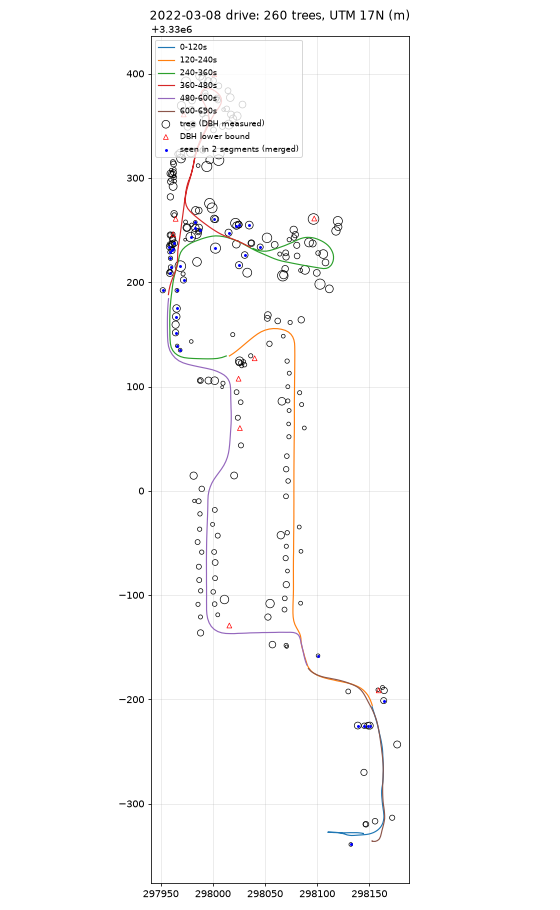
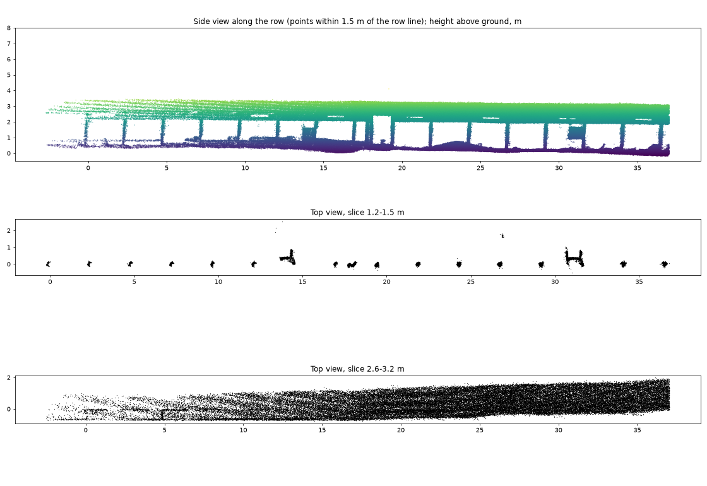
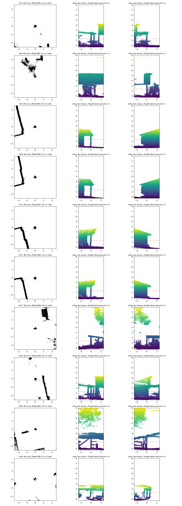
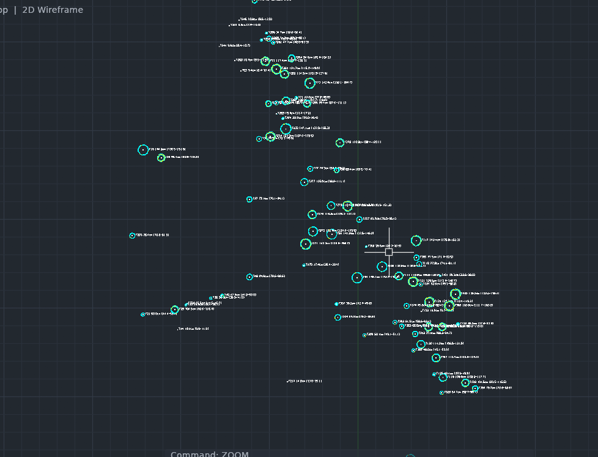
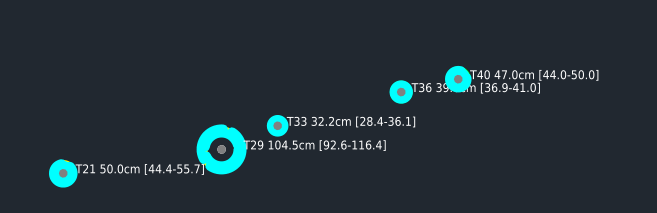
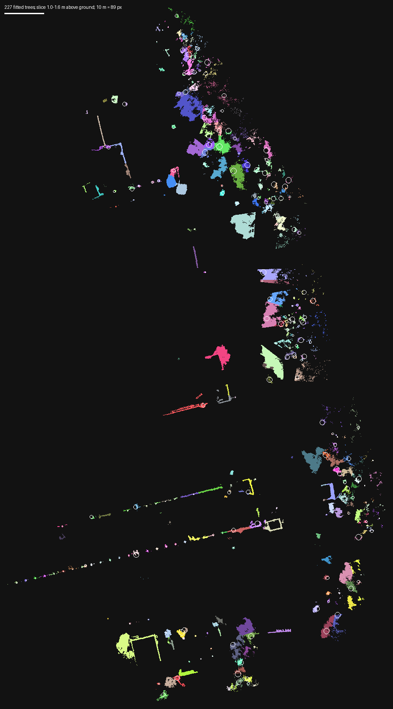
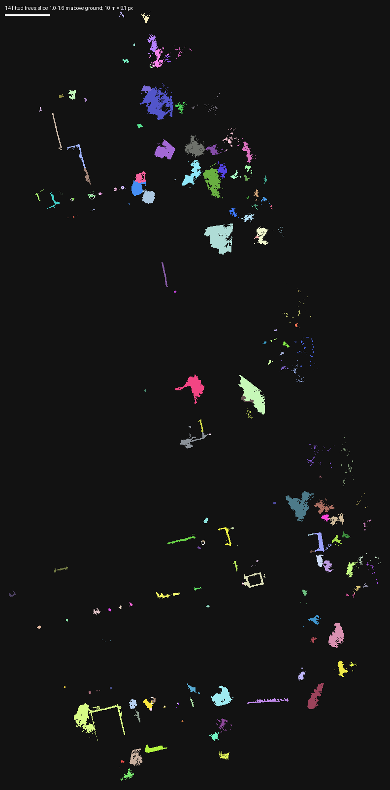

<div align="center">
  <h1>LiDAR Tree Inventory</h1>
  <p><b>Find trees in LiDAR point clouds, fit each stem, and measure DBH with a confidence interval.</b></p>
  <p>
    <a href="#1-install"></a>
    <a href="#1-install"></a>
    <a href="https://github.com/band72/lidar-historic-trees/actions/workflows/ci.yml"></a>
    <a href="LICENSE"></a>
  </p>
  
</div>

LiDAR Tree Inventory turns a point cloud of a forest plot into a tree list. For every tree it reports:

- position (x, y) and the **real-world elevation** of the ground and of the breast-height plane
- **DBH** (diameter at breast height) with a **confidence interval** (95 % by default) and a standard error
- quality flags that say when to distrust a measurement: one-sided scans, clutter, wide intervals
- basal area, plus any extra measurements added through plugins

Results can be explored in an interactive web app and exported as **CSV** (spreadsheets), **DXF** (CAD: DBH circles at true elevation), **GeoJSON** (GIS points or DBH circles) and a **segmented LAS/LAZ** point cloud. It reads PLY, PCD, LAS/LAZ (with units, CRS and ground classes from the header), text, NumPy and ROS bags.

It builds on the ICRA 2024 research code [PRBonn/forest_inventory_pipeline](https://github.com/PRBonn/forest_inventory_pipeline) (see [Citation](#citation)).

---

## Contents

1. [Install](#1-install): Windows, Linux, from source, Docker
2. [Quick start, preferred input and recommended workflow](#2-quick-start)
3. [Using the web app](#3-using-the-web-app)
4. [Using the command line](#4-using-the-command-line)
5. [Input data](#5-input-data): point clouds and ROS bags
6. [Outputs](#6-outputs): CSV, DXF, GeoJSON
7. [Configuration](#7-configuration)
8. [How the measurement works](#8-how-the-measurement-works)
9. [Calibrating the confidence interval](#9-calibrating-the-confidence-interval)
10. [Plugins](#10-plugins)
11. [Troubleshooting](#11-troubleshooting)
12. [Development](#12-development)
13. [Citation and license](#citation)

---

## 1. Install

### Windows 10 / 11 (64-bit)

1. Download **[LiDAR-Tree-Inventory-0.1.4-windows-x64-setup.exe](https://github.com/band72/lidar-historic-trees/releases/download/v0.1.4/LiDAR-Tree-Inventory-0.1.4-windows-x64-setup.exe)** from the [latest release](https://github.com/band72/lidar-historic-trees/releases/latest).
2. Run it. No administrator rights are needed: it installs for your user by default. On the first screen you can choose *Install for all users* instead, which needs admin.
3. Optional tasks during setup:
   - **Create a desktop shortcut**
   - **Add the `fip` command to PATH**, so you can use `fip` from any terminal
4. Start **LiDAR Tree Inventory** from the Start menu. A console window opens (it shows the log) and the app opens in your browser. Close the console window to stop the app.

Uninstall from *Settings → Apps*, or with *Uninstall LiDAR Tree Inventory* in the Start menu.

> Windows SmartScreen may warn that the installer is from an unknown publisher, because it isn't code-signed. Choose *More info → Run anyway*. Each release lists a `.sha256` checksum if you want to verify the download.

### Linux (x86_64)

Requires glibc 2.35 or newer: Ubuntu 22.04+, Debian 12+, Fedora 36+, Linux Mint 21+ and similar. Everything else is bundled, so you don't need Python.

```bash
# download (or use the link on the release page)
wget https://github.com/band72/lidar-historic-trees/releases/download/v0.1.4/LiDAR-Tree-Inventory-0.1.4-linux-x86_64.tar.gz
tar xzf LiDAR-Tree-Inventory-0.1.4-linux-x86_64.tar.gz
cd LiDAR-Tree-Inventory-0.1.4-linux-x86_64
./install.sh                 # for your user, no root needed
# or: sudo ./install.sh --system    (all users, installs to /opt)
```

The installer:
- copies the program to `~/.local/share/lidar-tree-inventory`
- adds the `fip` command to `~/.local/bin`
- adds **LiDAR Tree Inventory** to your applications menu and an icon on your desktop (skip the icon with `--no-desktop`)
- checks the installation with `fip self-test`

If it says `~/.local/bin` is not on your PATH, add this to `~/.bashrc`:

```bash
export PATH="$HOME/.local/bin:$PATH"
```

To uninstall, run `~/.local/share/lidar-tree-inventory/uninstall.sh` (or `/opt/lidar-tree-inventory/uninstall.sh` for a system install). Your own data and outputs are not touched.

### From source (for development or the latest code)

Tested on Linux and Windows (macOS is untested). You need Python 3.10–3.12, a C++20 compiler (GCC 11+, Clang 14+ or Visual Studio 2022) and CMake ≥ 3.28. On Linux, also install the Open3D system libraries:

```bash
sudo apt install build-essential libegl1 libgl1 libgomp1     # Debian/Ubuntu
git clone https://github.com/band72/lidar-historic-trees.git
cd lidar-historic-trees
python3 -m venv .venv && source .venv/bin/activate     # Windows: .venv\Scripts\activate
pip install -e ".[app,las]" rosbags                     # builds the C++ clustering extension
fip self-test
```

Optional extras: `app` (web interface), `las` (LAS/LAZ input), `dxf` (DXF export only), `test` (pytest). `rosbags` adds ROS bag input.

### Docker

The upstream Docker setup is still available in `docker/`. See the [upstream instructions](https://github.com/PRBonn/forest_inventory_pipeline#docker). It runs the original `fip instance` and `fip dbh` commands.

### Check the installation

```bash
fip self-test
```

This runs four checks and prints `PASS` or `FAIL` for each:

1. the plugins load
2. the full pipeline runs on a synthetic plot, with an accuracy check
3. the exports are written
4. the web app runs headlessly

---

## 2. Quick start

**No data yet? Use the demo plot.** It is a synthetic forest with known true DBH, so you can see how accurate the results and intervals are.

*Web app:* start **LiDAR Tree Inventory** (or run `fip`), keep **Demo plot** selected, and press **Run tree extraction**.

*Command line:*

```bash
fip demo-data demo/plot.ply              # writes demo/plot.ply and demo/plot_truth.csv
fip inventory demo/plot.ply -o results   # writes results/trees.csv, results/trees.dxf, results/fip.log
```

**Your own data:** follow the [recommended workflow](#recommended-workflow) below. In short:

```bash
fip inventory /data/plot.laz -o results       # preferred input: a LAS/LAZ file
```

Open `results/trees.csv` in a spreadsheet, or `results/trees.dxf` in a CAD program (AutoCAD, BricsCAD, LibreCAD, QGIS).

### Preferred input file

**A LAZ (or LAS) file in a projected coordinate system, in metres or feet.** It is the best choice because the file itself tells the program what it needs to know:

| | LAS / LAZ (preferred) | PLY / PCD | TXT / CSV / NPY | ROS bag |
|---|---|---|---|---|
| Units and coordinate system | read from the header | you must pass `--units` (and `--crs` to record a CRS) | same as PLY/PCD | metres (the ROS convention) |
| Ground points | reused if classified (ASPRS class 2), saving a step | not available | not available | not available |
| Noise points | removed (classes 7 and 18) | not available | not available | not available |
| Cut out one plot from a big file | `--crop`, applied while reading | after loading | after loading | after loading |
| Outputs placed correctly in GIS/CAD | yes: `.prj`, GeoJSON and the segmented LAZ carry the CRS | only with `--crs` | only with `--crs` | only with `--crs` |

What makes a good input:

- **Projected coordinates**, such as UTM or State Plane, in metres or feet. Longitude/latitude files are refused, so reproject them first.
- **Stems visible from the ground up to at least 1.5 m**, since the measurement uses a band around breast height (1.3 m by default). Don't clip the cloud to a height range: the program needs the ground and the lower trunk, and does its own height slicing.
- **Scanned from several positions** (walk a loop, or use several set-ups) so each stem is seen from more than one side. Stems seen from one side only get a warning and a wider interval.
- **Dense enough on the stems.** In the demo plots each tree has several hundred to a few thousand points in the 50 cm band. A tree with fewer than 30 band points fails, and the log tells you.
- **Ground classified, if you can.** Optional. When the file has ground points (class 2), they are used directly, so you control what counts as ground and the ground-finding step is skipped. Without them the program runs its own ground filter.
- **One plot per file, or a folder of tiles** with the same units and coordinate system. Everything is one plot, so crop a large file to the plot first.

If your scanner software produces something else (E57, RCP, PTS), export it to LAZ first. For a robot or backpack scan in a ROS bag, run SLAM first and use the *registered* cloud topic, or export it to LAZ ([details](#ros-bags-ros1-bag-ros2-folder-db3-mcap)).

### Recommended workflow

The first four steps are quick to repeat, so iterate there before spending time on calibration.

**1. Prepare the data.** Export your scan as LAZ in a projected CRS. If your software can classify ground, do so. Note the plot boundaries in the file's coordinates if the file is bigger than the plot.

**2. Check the installation** (once): `fip self-test`.

**3. First run on a small area.** Work on a 30–50 m box first, so each run takes seconds (the box is `xmin,ymin,xmax,ymax` in the file's own coordinates and units):

```bash
fip inventory plot.laz -o run1 --crop 656100,1312300,656164,1312364 \
    -e csv -e dxf -e geojson -e points
```

or in the web app: choose the file, enter the same box in *Crop*, press **Run tree extraction**.

**4. Check that the trees were found correctly.** Open `run1/trees.laz` in CloudCompare or QGIS and colour by `tree_id`: each tree should be one colour. In the app, look at the **Map** tab. Then adjust and re-run:

| What you see | Change |
|---|---|
| Two trees share one colour | lower `segment.k` or `segment.beta` (the app's *Merged trees* option also splits these) |
| One tree has several colours | raise `segment.k` or `segment.beta` |
| Bushes or branches become "trees" | raise *Min points per tree*, or raise `segment.min_z` |
| Trees missing entirely | check the height slice contains breast height; lower `min_z` |
| Trees' ground height looks wrong | `--ground-source csf`, or adjust the cloth resolution |

**5. Check the measurements.** In the app's **Table & export** tab, filter to *warning* and *failed* and read the `message`. Open **Tree detail** for a few trees, including a large one and a leaning one, and check that the fitted circle follows the points. Use the live sliders to set the *breast height* your organisation uses (1.3 m, or 4.5 ft in the US), the *confidence level* and the *band*. Trees flagged for low arc coverage were seen from one side only: treat their intervals as the honest ones, and don't tighten them. If the scanner moved around the plot, try *Complete partly seen stems* (`--complete-partial`) to measure them from a taller window.

**6. Calibrate the interval** with tape-measured trees ([section 9](#9-calibrating-the-confidence-interval)). Measure 15–30 trees in the plot, record their positions in the same coordinate system, and run:

```bash
fip calibrate run1/trees.csv field.csv        # suggests a model_sd
```

Put the suggested `model_sd` in your config. This is the step that makes the intervals trustworthy on *your* scanner and forest. Repeat it if you change scanner, season or forest type.

**7. Final run, on the whole plot, with saved settings.** Copy [`config/inventory.yaml`](config/inventory.yaml), keep only the values you changed, and run:

```bash
fip inventory plot.laz -o final -c my_settings.yaml -e csv -e dxf -e geojson -e points
```

For several plots use the same settings file for all of them, so results are comparable.

**8. Georeference a SLAM run (optional).** If the cloud is in local SLAM coordinates and GNSS was recorded, `fip georeference` adds latitude and longitude to every tree and writes a GPX file for finding them in the field ([details](#fip-georeference)).

**9. Deliver and keep the record.** Use `trees.csv` (tables, spreadsheets), `trees.dxf` (CAD drawings with each DBH circle at its true elevation), and `trees.geojson` (GIS). Keep the whole output folder: `run.json` records the inputs, settings, software version and a checksum of every file, and `fip.log` shows how each tree was handled.

The same steps work in the web app: choose the file, set *Crop*, press **Run tree extraction**, adjust the live sliders, then download the files from the **Table & export** tab. The **Calibration** tab applies the suggested `model_sd` with one click.

---

## 3. Using the web app

Start it from the menu, or with `fip` or `fip app`. It runs locally at `http://localhost:8501` and opens in your browser. Your data never leaves your computer.

The sidebar has three steps.

### Step 1 · Point cloud

Choose **Display & export units** at the top: *same as cloud*, *m / cm*, *ft / in* or *US ft / in*. This sets the units of the map, the table, the charts and every download. In feet mode, the breast-height slider is in feet (default 4.5 ft).

- **Demo plot**: a synthetic plot. Choose the number of trees and a random seed.
- **Choose file**: a file chooser for this computer's disk. Open folders from the list (⬆ goes up a level), or type or paste a path into *Folder*. Then pick a point cloud file (📄, any [supported format](#5-input-data), shown with its size), a ROS2 bag folder (🎒), or **Use all … files in this folder** to merge a folder of tiles. The file is read in place, so this is the way to open large files. The chooser starts in the folder you used last time. For ROS bags, a *ROS bag options* panel appears, with topic, target frame, every n-th message and more.
- **Upload**: drag a file into the browser, up to 4 GB.
- **Point cloud units** (for files): metres, feet or US survey feet.

### Site profile

The **Site profile** dropdown, above *2 · Find trees*, sets the ground, segmentation and fit settings for a kind of site. It moves the sliders, so you can still adjust any of them; a note then says how many settings differ from the profile. Ground and segmentation changes apply when you press **Run tree extraction**; fit changes apply at once. The **Settings** tab records the profile you started from, and the command line takes the same profiles with `--profile`.

| Profile | For | What it changes |
|---|---|---|
| Default | Mixed sites | Nothing: the pipeline's defaults |
| Shrubs | Trees among dense shrubs and saplings | Stricter trunk check (more of the points on the trunk, emptier inside); objects must reach 1.5 m above breast height; minimum DBH 7.5 cm |
| Isolated Trees | Parks, open ground, roadsides, fence lines; trees scanned in passing | Smaller clusters (k 100) keep neighbours apart; tilt up to 30°; 400 points/m² on the trunk; *Complete partly seen stems* on. More found, less certain: on the test drive +18/-4 trees on one segment, of the added ones reviewed about half clear trees (one a large leaning trunk), the rest a pole and ambiguous objects |
| Clear Forest | Open understory, many straight stems close together | Stems split at a 10 cm gap; tilt up to 15° (steeper is usually a branch); ground rigidness 2 for forest terrain |
| Tall Wide Trees | Tall trees with wide crowns | Trunk checked up to 3.5 m; DBH up to 2 m; 400 points/m² on the trunk (seen from farther away); 1 m ground cloth for ground hidden under crowns |
| Large DBH Trees | Big old and heritage trees | DBH up to 3 m; 30 cm stem gap so one big trunk seen in pieces is not split; 6 % non-roundness; tilt up to 30°; 300 points/m²; minimum DBH 20 cm. On the test drive it found 83 of the 88 trees of 20 cm or more found with the defaults, plus 6 |

The profiles are reasoned starting points, not settings calibrated on your data. None of them changes the segmentation: coarser clusters merged neighbouring trees on the test drive and lost half of them. After a run, check the map and a few rejected clusters, and adjust.

### Step 2 · Find trees

These are the slow steps. Adjust the settings, then press **Run tree extraction**.

| Setting | What it does | When to change it |
|---|---|---|
| Cloth resolution | Grid of the ground filter (CSF) | Larger on rough terrain with gaps; smaller for fine micro-relief |
| Ground class threshold | How close to the cloth a point must be to count as ground | Rarely |
| Ground refinement tolerance | Points this far above the local terrain are not ground. This removes stem bases from the terrain model | Raise it on very rough ground |
| Rigidness | 1 = steep terrain, 3 = flat | Steep slopes → 1 |
| Neighbours k | Clustering neighbourhood | Trees merged → lower; trees split into pieces → higher |
| Density β | Cluster merging | Higher → fewer, larger clusters |
| Voxel size | Downsampling for clustering only; fitting always uses all points | Very dense clouds → larger |
| Height slice | Height range above ground used to find trees; must contain breast height | Dense undergrowth → raise the lower bound |
| Min points per tree | Smaller clusters are ignored | Sparse scans → lower |

### Step 3 · Fit stems (live)

These sliders update every result instantly.

| Setting | Default | Meaning |
|---|---|---|
| Breast height | 1.3 m | Height of the DBH measurement (1.37 m = 4.5 ft in the US) |
| Band half-width | 0.25 m | Points within breast height ± this are used for the fit |
| Confidence level | 0.95 | Coverage of the reported interval |
| CI method | analytic | *analytic* is instant; *bootstrap* is slower and makes fewer assumptions ([details](#8-how-the-measurement-works)) |
| Systematic uncertainty | 0.5 cm | Error the scan itself can't reveal. **Calibrate it** with field data ([section 9](#9-calibrating-the-confidence-interval)) |
| Fitting details | | Inlier tolerance, robust kernel scale, max DBH, max stem tilt, RANSAC iterations, bootstrap resamples |
| Quality flags | | Thresholds that turn a tree's status into *warning* (arc coverage default 60 %), and the assumed *stem non-roundness* that widens the interval of partly seen stems |
| Partly seen stems | off | *Complete partly seen stems*: measure flagged stems over a taller window so other heights complete the circle |
| Merged trees | on, 15 cm | Splits clusters that contain several stems, which recovers trees the segmentation merged |

### The main area

- **Summary**: trees fitted, mean DBH, basal area per hectare, and the median CI width. For the demo plot it also shows the RMSE and CI coverage against the true values.
- **💾 Save results to a folder**: choose an output folder (it starts next to your input file), a name for the run's subfolder (default `<file>_inventory`) and the formats, then press **Save results**. This writes CSV, DXF, GeoJSON, the segmented points, `run.json` and, when the CRS is known, `trees.prj`. It is the same set of files `fip inventory` writes.
- **Map**: tree positions sized by DBH. Status is shown by color, shape and label together (✔ ok, ⚠ warning, ◬ DBH lower bound, ◇ check: pole or shrub?, ✖ failed, ⊘ excluded, ✚ added by reviewer). Hover for details, and click a tree to select it. Below it, **🌍 Georeference** puts the trees on a satellite map and gives the GPX, GeoJSON, CSV and [field sheet](#field-check) for the field (see [`fip georeference`](#fip-georeference)).
- Below the map is a **DBH chart**: every tree's DBH with its confidence interval.
- **Tree detail**: the breast-height slice with the fitted circle and the CI circles, and a 3D view of the tree with the fitted cylinder. For a measured tree: **Exclude this tree** (with a reason). For a rejected cluster that is a real tree: **✚ This is a tree** (with a reason); it becomes `added`, a position without a DBH, in the map, CSV, GeoJSON, GPX and DXF (a cross on layer `FIP_ADDED`), and **Not a tree after all** undoes it. Both are saved in `exclusions.json` and reapplied by position.
- **Table & export**: **Exclude from the results (reviewer)** lists trees you choose to leave out, such as a shrub or structure that passed the checks (or use **Exclude this tree** in *Tree detail*, with an optional reason). Excluded trees stay in the CSV with status `excluded` and an `exclusion_reason`, are left out of totals, the map, DXF and GeoJSON, and are listed in `run.json`. Saving results also writes `exclusions.json`. Load it again under **Reuse a saved review** (or pass `--exclusions` on the command line) to exclude the same trees in a later run: trees are matched by stem position, within 30 cm, so this works after changing settings. Below it, a filterable table with download buttons for every exporter (CSV, DXF and any plugins). Each exporter's options are shown above its button.
- **Calibration**: upload field measurements to estimate the systematic uncertainty, then apply it with one click.
- **Settings**: every setting of the current extraction as a YAML file. Save it next to your results, or download it, to repeat the run or to use it from the command line (`fip inventory INPUT -c inventory.yaml`).
- **Log**: the application log, which you can filter to warnings or errors.

---

## 4. Using the command line

Run `fip --help` for the command list, and `fip <command> --help` for a command's options.

| Command | Purpose |
|---|---|
| `fip` (no arguments) or `fip app` | Start the web app |
| `fip inventory INPUT` | Full inventory: CSV + DXF (+ other exports) |
| `fip calibrate TREES_CSV FIELD_CSV` | Estimate the systematic uncertainty from field data |
| `fip georeference TREES_CSV -t TRAJ -g GNSS` | Latitude/longitude for every tree of a locally registered (SLAM) run, plus GPX for the field |
| `fip plugins` | List readers, exporters and metrics |
| `fip demo-data OUTPUT` | Write a synthetic plot with true DBH values |
| `fip self-test` | Check the installation |
| `fip instance`, `fip dbh` | The original research pipeline (unchanged) |

### `fip inventory`

```bash
fip inventory INPUT... [options]     # one or more files, or a folder of tiles
```

| Option | Description |
|---|---|
| `-o, --output DIR` | Output folder (default `fip_output`). It holds the exports and `fip.log` |
| `-c, --config FILE` | YAML/JSON settings file, see [Configuration](#7-configuration) |
| `-e, --export NAME` | Exporter to run; repeatable: `csv`, `dxf`, `geojson`, `points` or a plugin. Default: `-e csv -e dxf` |
| `-E, --export-option NAME.KEY=VALUE` | Exporter option, e.g. `-E dxf.z_mode=plan`; repeatable |
| `--reader NAME` | Force a reader (normally picked from the file extension) |
| `-R, --reader-option KEY=VALUE` | Reader option, e.g. `-R topic=/points`; repeatable |
| `--plugin-dir DIR` | Load extra plugins from this folder; repeatable |
| `-u, --units auto\|m\|ft\|us_ft` | Length unit of the input (`auto` = from the LAS header, else metres), and of `--breast-height`, `--model-sd` and `--crop` (see [Metres and feet](#metres-and-feet)) |
| `--crop XMIN,YMIN,XMAX,YMAX` | Process only this box (input coordinates); LAS is cropped while reading |
| `--ground-source auto\|csf\|classification` | Ground from the file's classification if present (`auto`), always CSF, or require the classification |
| `--crs EPSG:xxxx` | Coordinate system to record in the outputs (default: from the file header) |
| `--keep-noise` | Keep points classified as noise (ASPRS 7/18) |
| `--output-units m\|ft\|us_ft` | Length unit of the exports (default: same as `--units`) |
| `--breast-height H` | Override the breast height (in `--units`; default 1.3 m, or 4.5 ft for feet) |
| `--confidence P` | Override the confidence level, e.g. `0.9` |
| `--ci-method analytic\|bootstrap` | Override the CI method |
| `--exclusions FILE` | Reapply a saved review (`exclusions.json`): exclusions and *This is a tree* additions, matched by position |
| `--profile NAME` | Start from a [site profile](#site-profile) (`Shrubs`, `"Isolated Trees"`, ...); `-c` files and other options override its values. Recorded in `run.json` |
| `--complete-partial` | Complete stems seen from one side by measuring over a taller window ([details](#stems-that-are-only-partly-visible)) |
| `--model-sd S` | Override the systematic uncertainty (in `--units`) |
| `--exclusions FILE` | Reapply a saved review: the `exclusions.json` of an earlier run (or its folder). Trees are matched by stem position, so this works after changing settings |
| `--log-level trace\|debug\|info\|warn` | Console verbosity (the log file always has full detail) |

Examples:

```bash
# every format: table, CAD, GIS circles, and the segmented cloud for checking in CloudCompare
fip inventory plot.laz -o out -e csv -e dxf -e geojson -e points -E geojson.geometry=circle

# a 50 m plot cut from a large State Plane tile; units and CRS come from the header
fip inventory big_tile.laz -o out --crop 656100,1312300,656264,1312464

# a folder of tiles, European Excel CSV, DXF as a flat 2D plan
fip inventory tiles/ -o out -E csv.delimiter=semicolon -E csv.decimal=comma -E dxf.z_mode=plan

# a US plot in feet: 4.5 ft breast height, 90 % intervals, bootstrap; outputs in feet and inches
fip inventory plot.laz -o out --units ft --confidence 0.9 --ci-method bootstrap

# everything from a settings file
fip inventory plot.laz -o out -c config/inventory.yaml
```

Exit codes: `0` success, `2` invalid input or settings (with a clear message), `1` unexpected error (full traceback in `fip.log`).

### `fip app`

| Option | Description |
|---|---|
| `--port N` | Port (default 8501; the next free port is used if it's taken) |
| `--no-browser` | Don't open a browser window |
| `--address A` | `127.0.0.1` (default, this computer only), or `0.0.0.0` to share on your network |
| `--plugin-dir DIR` | Extra plugins |

### `fip calibrate`

```bash
fip calibrate out/trees.csv field_measurements.csv [--dbh-unit auto|m|cm|in|ft] [--xy-unit m|ft|us_ft] [--max-distance 0.5] [--current-model-sd 0.005]
```

See [section 9](#9-calibrating-the-confidence-interval).

### `fip georeference`

A SLAM or KISS-ICP run is in local metres (origin at the first scan). If GNSS was recorded during the drive, this gives every tree a latitude and longitude, so you can find the trees again in the field:

```bash
fip georeference out/trees.csv -t segment_trajectory.csv -g drive.bag -o out
```

| Option | Description |
|---|---|
| `-t, --trajectory FILE` | Scanner trajectory CSV `time_s,x,y[,z]` in the same local frame (written by `scripts/register_rosbag_kiss_icp.py`) |
| `-g, --gnss FILE` | GNSS fixes: a CSV `time_s,lat,lon[,alt,h_sd]`, a ROS bag or a ROS2 bag folder with `sensor_msgs/NavSatFix` |
| `--gnss-topic T` | Use only these NavSatFix topics (default: all; two antennas are pooled) |
| `-a, --alignment FILE` | Reuse the `georef.json` of an earlier run instead of fitting |
| `-o, --output DIR` | Output folder (default: next to `TREES_CSV`) |

It fits a 2D rotation and shift (no scale; lidar odometry is metric) from the trajectory to the fixes recorded at the same times, dropping outlier fixes, and writes:

- `trees_wgs84.csv`: every column of `trees.csv` plus `lat`, `lon` and `position_sd_m`
- `trees_wgs84.geojson`: measured trees as WGS84 points (RFC 7946), for any GIS or phone map app
- `trees.gpx`: waypoints named `T12 26cm` (`T12 >=24cm` for a lower-bound DBH, `T40 added` for a tree kept by a reviewer), for a handheld GPS or a phone app (OsmAnd, Gaia GPS, SW Maps)
- `field_sheet.csv`: one row per tree, named as in the GPX, with blank columns `tape_dbh_cm`, `is_tree`, `species`, `notes` to fill in on site ([field check](#field-check))
- `georef.json`: the transform, residuals and accuracy; `gnss_fixes.csv`: the fixes used

Accuracy is that of the GNSS. Standalone fixes (no RTK) are good to about ±1 m, and the offset between the GNSS antenna and the lidar (not modelled) adds to that. The fit's residual RMS shows how well the run's shape matches the GNSS track. It cannot reveal a constant GNSS bias. Heights are not georeferenced.

The app does the same on the **Map** tab (*Georeference: satellite map and GPX*): choose the trajectory and the GNSS file (or a `georef.json`), and the trees are shown on satellite imagery (tiles loaded by your browser from Esri's public service; OpenStreetMap when switched off), with the GPX, GeoJSON, CSV and field sheet to download.

### `fip merge`

Long drives are processed in segments (one KISS-ICP run each), each in its own local frame. After `fip georeference` on every segment, this makes **one map of the whole drive**:

```bash
fip merge drive/segment_*/ -o drive/merged
```

Writes `trees_merged_wgs84.csv` (with `utm_e`, `utm_n` and the EPSG code of the UTM zone, plus `run`, `run_tree_id` and `also_seen_in`), `trees_merged_wgs84.geojson`, `trees_merged.gpx`, `field_sheet.csv`, `trees.dxf` on the UTM grid (opens in place in CAD/GIS with that CRS) and `merge_report.json`.

A tree seen in two segments is kept once (the better measurement: ok before warning, measured before lower-bound DBH, then the narrower interval). Separate GNSS alignments disagree by a metre or more, and on a weak segment (residual several metres, e.g. under canopy) by more, so before merging **each segment is tied to the others by the trees they share**: the median offset of mutual nearest pairs with agreeing DBH, used only when at least 5 pairs agree to within 0.75 m. Then records closer than `--distance` (1.5 m) with agreeing DBH are merged. `merge_report.json` lists every shift and every merged pair with its distance, to check. `--no-tie` turns tying off (the merge distance then widens with the position uncertainty, up to 3 m).

### Field check

`field_sheet.csv` (from `fip georeference` or `fip merge`, or the app) is the form for checking the map on site. Walk to each waypoint, fill in `tape_dbh_cm` (DBH by tape, at your breast height) and `is_tree` (`yes`/`no`), then:

```bash
fip calibrate out/trees.csv field_sheet.csv      # or merged/trees_merged_wgs84.csv
```

It matches the sheet to the trees by `tree_id`, reports how many visited objects were not trees (the false-positive rate), and estimates DBH bias, RMSE, interval coverage and the `model_sd` to use ([calibrating](#9-calibrating-the-confidence-interval)). Trees with a lower-bound DBH and reviewer-added trees are not used for the DBH statistics.

---

## 5. Input data

### Point cloud files

**LAS, LAZ and PLY are the primary formats.** LAS and LAZ (versions 1.0-1.4, any point format, compressed or not) are preferred, and the table in [section 2](#preferred-input-file) says why. PLY files can be binary or ASCII, with float or double coordinates, and with colours or other properties: only the x, y, z are used, and large georeferenced coordinates keep their full precision. Every format is covered by automated tests, and the same plot stored as LAS, LAZ and PLY gives identical results.

| Format | Extensions | Notes |
|---|---|---|
| PLY / PCD / XYZ | `.ply .pcd .xyz .xyzn .xyzrgb .pts` | Read with Open3D |
| LAS / LAZ | `.las .laz` | Reads **units and coordinate system from the header**, keeps the **ground classification**, drops noise points (classes 7/18), and can **crop while reading** to save memory. LAZ is supported in the installers and with the `las` extra |
| NumPy | `.npy` | An `N × 3` (or wider) array |
| Text | `.txt .csv .asc` | The first three numeric columns are x, y, z. Header lines are skipped and the delimiter is detected automatically |

**Several files / tiles:** pass several files (`fip inventory a.laz b.laz`) or a folder (`fip inventory tiles/`). They are merged into one plot, and must share the same units and coordinate system.

**Cropping:** `--crop xmin,ymin,xmax,ymax` (in the file's coordinates) processes only that box. For LAS/LAZ it's applied while reading, so a plot can be cut from a multi-gigabyte tile without loading the whole tile. In the app, use the *Crop* field.

**Existing ground classification:** if a LAS file has ground points (ASPRS class 2), they are used directly instead of re-running the ground filter (`--ground-source auto`, the default). Use `--ground-source csf` to always run CSF, or `classification` to insist on the file's classes.

**Coordinate system:** the CRS in the LAS header (WKT or GeoTIFF keys) is detected and passed to every output: `trees.prj`, GeoJSON, the segmented LAS and `run.json`. Override it, or set it for files without one, with `--crs EPSG:xxxx`. Files in longitude/latitude are refused with a message, because they need reprojecting to metres or feet first.

Requirements:
- **Units: metres or feet.** Tell the program which one your cloud uses (see [Metres and feet](#metres-and-feet) below). Clouds in millimetres must be converted first.
- The cloud should cover the stems from the ground up to at least 1.5 m. Terrestrial, mobile (backpack/robot/handheld) and dense UAV scans work. Typical airborne LiDAR is too sparse on the stems.
- One plot per file. Very large clouds (more than about 50 million points) are best cropped or thinned first.

### Metres and feet

| Unit | Name in the program | Exactly |
|---|---|---|
| metre | `m` (default) | |
| international foot | `ft` | 0.3048 m |
| US survey foot | `us_ft` | 1200/3937 m. Many US State Plane systems use it; over large coordinate values it differs from `ft` |

- **Input:** detected automatically from LAS headers (`--units auto`, the default; files without units are assumed to be metres). Set it with `--units ft` / `us_ft` / `m`, or *Point cloud units* in the app. The cloud is converted to metres on reading, and all calculations run in metres.
- **Output:** exports use the same unit as the input by default, so a feet cloud gives feet CSV, DXF and GeoJSON with your **original coordinates**. Choose differently with `--output-units m`, per exporter with `-E dxf.units=m`, or with *Display & export units* in the app.
- **DBH:** shown in cm for metric output and in **inches** for feet. The CSV always has both `dbh_cm` and `dbh_in`, and a `length_unit` column says which unit the other lengths are in.
- **US breast height:** with `--units ft` or `us_ft`, breast height defaults to **4.5 ft** (1.37 m). `--breast-height` and `--model-sd` are then given in feet too, e.g. `--breast-height 4.5`.
- **Config files** (`-c`) always use metres.
- If a cloud's size suggests it's in feet but you didn't say so, the log warns you.

```bash
fip inventory stateplane.laz --units us_ft -o out            # outputs in US survey feet, DBH in inches
fip inventory plot_ft.las --units ft --output-units m -o out # read feet, write metres
```

### ROS bags (ROS1 `.bag`, ROS2 folder, `.db3`, `.mcap`)

The `rosbag` reader collects `sensor_msgs/PointCloud2` messages from one topic. You don't need a ROS installation. What matters is **which frame the clouds are in**:

| Your bag contains | What to do |
|---|---|
| A registered/mapped cloud topic (e.g. `/cloud_registered` from FAST-LIO, a `/map` topic) | `-R topic=/cloud_registered` |
| Raw scans in the sensor frame, **plus** `/tf` from SLAM/odometry | `-R topic=/os_cloud_node/points -R target_frame=map`. Each scan is transformed with the pose at its timestamp |
| Raw scans with no poses (or only GNSS/INS, which is usually too coarse for DBH) | Register them with lidar odometry first. The included script does this with KISS-ICP: `pip install kiss-icp`, then `python scripts/register_rosbag_kiss_icp.py run.bag --topic /os_cloud_node/points --start 0 --duration 120 -o segment.laz`, then `fip inventory segment.laz`. It removes motion blur using per-point times, drops no-return pixels and levels the cloud with the lidar's IMU. Coordinates are local (origin at the first scan); keep segments to a few minutes, since odometry drifts slowly. Stacking raw scans without poses smears the trees, so the reader refuses with an explanation |
| A static scanner | `-R allow_sensor_frame=true` |

Other rosbag options:

| Option | Meaning |
|---|---|
| `every_nth` | Use only every n-th message |
| `max_messages` | Stop after this many messages |
| `min_range` / `max_range` | Distance filter in the sensor frame |
| `voxel_size` | De-duplication grid for the accumulated cloud (default 1 cm) |
| `tf_tolerance` | Seconds a scan may lie outside the `/tf` time range |

If the bag has a single PointCloud2 topic, the reader uses it automatically. Otherwise the error message lists the topics available.

---

## 6. Outputs

### `trees.csv`: one row per tree

Lengths are in the output unit named in the `length_unit` column: metres by default, or feet ([details](#metres-and-feet)). Failed trees are included, with a reason, unless you pass `-E csv.include_failed=false`.

| Column | Meaning |
|---|---|
| `tree_id` | Tree number |
| `status` | `ok`, `warning` (measured, but check `message`), `failed` (not measurable; see `message`), `excluded` (removed by a reviewer) or `added` (rejected by the checks but kept as a tree by a reviewer: a position without a DBH) |
| `length_unit` | `m`, `ft` or `us_ft`: the unit of every length column below |
| `x`, `y` | Stem centre at breast height, in the input coordinate system |
| `ground_z` | Terrain elevation under the stem |
| `breast_height` | Height used (e.g. 1.3) |
| `bh_elevation` | **Absolute elevation of the DBH plane** = `ground_z + breast_height` |
| `dbh`, `dbh_cm`, `dbh_in` | DBH in the length unit, in cm, and in inches |
| `dbh_se` | Standard error of the DBH (includes the unseen-part allowance below) |
| `view_sd` | The part of that error that comes from the stem's unseen side (0 for a stem seen all round) |
| `ci_low`, `ci_high` | Confidence interval bounds |
| `confidence`, `ci_method` | Interval level and method |
| `n_points`, `n_band_points` | Points in the tree, and in the breast-height band |
| `band_half_width` | Half-height of the measurement window used: 0.25 m normally, more when a partly seen stem was completed |
| `dbh_method` | `breast-height band`; `taller window (taper)` for a partly seen stem completed with `--complete-partial`; `visible width (lower bound)` for a stem seen over too little of its circumference to fix the diameter ([details](#8-how-the-measurement-works), "Stems seen through a gap") |
| `inlier_ratio` | Share of band points on the fitted stem surface |
| `rmse` | Fit residual (m) |
| `arc_coverage`, `max_gap_deg` | How much of the stem circumference was scanned, and the largest unscanned gap |
| `tilt_deg`, `axis_x/y/z` | Stem lean |
| `message` | Warnings or the reason a fit failed |
| `cluster_id` | Segmentation cluster (differs from `tree_id` when merged trees were split apart) |
| `large_tree` | `yes` when the DBH is at least `fit.large_tree_dbh` (default 0.5 m, about 20 in) |
| `crown_share` | Share of the material 2.5 m and higher within 3 m of the stem that lies away from the stem column: 0.5-0.9 under a crown, near 0 for a bare column (a pole, a dead snag, or a trunk whose crown is above the scanner's view) |
| `visible_height_m` | Top of what the scanner saw above the stem (99th percentile within 1 m of it), in metres. A vehicle lidar often cannot see crown tops, so this is a lower bound on tree height, not the height |
| `exclusion_reason` | The reviewer's reason for an `excluded` or `added` tree |
| `basal_area_m2`, `basal_area_ci_low_m2`, `basal_area_ci_high_m2` | Basal area and its interval |

### `trees.dxf`: CAD drawing (metres or feet)

Each tree's DBH is drawn as a **circle with diameter = DBH, lying flat in a horizontal plane**. `-E dxf.z_mode=...` sets where that plane is:

| `z_mode` | The circle's z |
|---|---|
| `elevation` (default) | The actual elevation of breast height (`bh_elevation`), so circles float at true height above the terrain |
| `height` | Breast height above ground (e.g. 1.3) for every tree |
| `plan` | 0, a flat 2D plan |

Layers:

| Layer | Content |
|---|---|
| `FIP_DBH` | DBH circles of `ok` trees (green) |
| `FIP_DBH_WARN` | DBH circles of `warning` trees (yellow) |
| `FIP_CI` | Dashed circles at the lower and upper CI bounds |
| `FIP_CENTER` | Stem centre points |
| `FIP_LABEL` | Text such as `T12 34.2cm [33.1-35.3]` |
| `FIP_AXIS` | Line from the ground to breast height (elevation mode only) |

Each DBH circle also carries extended data (XDATA, application id `FIP`): the tree id, DBH, CI, status and units. In feet the drawing's units are set to feet (or US survey feet for `us_ft`), and labels show inches. Other options: `include_ci`, `include_labels`, `include_axis`, `text_height`, `units`.

### `trees.geojson`: for GIS (`-e geojson`)

One feature per tree, with DBH, CI, status and metric properties, for QGIS, ArcGIS or web maps:
- `-E geojson.geometry=point` (default): a point at `[x, y, bh_elevation]`
- `-E geojson.geometry=circle`: the DBH cross-section as a polygon, so stems draw to scale on a map

The input's CRS is recorded (override with `-E geojson.crs=EPSG:xxxx`). Projected coordinates are written as they are, which QGIS and GDAL read correctly.

### `trees.laz`: segmented point cloud (`-e points`)

Every point of every tree, at its **real elevation**, with extra dimensions `tree_id` and `height_above_ground`. Open it in CloudCompare or QGIS and colour by `tree_id` to check the segmentation against the table. Format: `-E points.format=laz|las|ply`. The input CRS is written into LAS/LAZ files. It contains the height slice that was segmented (`segment.min_z`..`max_z`), not the whole input cloud.

### `run.json` and `trees.prj`

Every run also writes:
- **`run.json`**: the software version, time, input files, input and output units, CRS, all parameters, the result summary, and every output file with its size and SHA-256 checksum, so a result can be traced and verified later
- **`trees.prj`**: the coordinate system as WKT (when known), which lets GIS software place `trees.csv` and the DXF correctly

### CSV options

`-E csv.delimiter=comma|semicolon|tab`, `-E csv.decimal=point|comma` (use `semicolon` + `comma` for Excel in German, French and similar locales), `-E csv.precision=4`, `-E csv.include_failed=true|false`, `-E csv.units=auto|m|ft|us_ft`.

### `fip.log`

A detailed log of the run: every stage, its timing, warnings, and for each failed tree the reason. Unexpected errors include a full traceback. The web app logs to `fip_output/app.log` when run from source. Installed copies log to `%LOCALAPPDATA%\LiDARTreeInventory\logs` on Windows and `~/.local/state/lidar-tree-inventory/logs` on Linux.

---

## 7. Configuration

Every setting has a sensible default. To change them for the command line, copy [`config/inventory.yaml`](config/inventory.yaml), edit it, and pass it with `-c`. That file documents every key. The main ones:

```yaml
ground:
  cloth_resolution: 0.5     # CSF grid (m)
  rigidness: 3              # 1 steep ... 3 flat
  refine_tolerance: 0.15    # remove "ground" points this far above the terrain (stem bases)
segment:
  k: 150                    # clustering neighbours
  beta: 0.5                 # cluster merging
  min_z: 1.0                # height slice used to find trees
  max_z: 4.0
fit:
  breast_height: 1.3
  band_half_width: 0.25
  confidence: 0.95
  ci_method: analytic       # or bootstrap
  model_sd: 0.005           # systematic uncertainty (m); calibrate it
  split_stems: true         # recover trees merged by segmentation
  min_arc_coverage: 0.6     # stems scanned from fewer sides than this are flagged
  complete_partial_stems: false  # true: measure flagged stems over a taller window to see more of the circle
  ovality_sd: 0.03          # assumed stem non-roundness; widens intervals of partly seen stems
```

Invalid values are rejected with a message naming the setting and its valid range.

---

## 8. How the measurement works

1. **Ground.** The Cloth Simulation Filter separates ground points. A refinement step then removes stem bases that CSF labelled as ground. Without it, the terrain under each tree is lifted (about 0.4 m in tests), which moves the "1.3 m" band up the stem and biases DBH low on tapered stems.
2. **Height normalization.** Each point's height above the interpolated terrain is computed (inverse-distance weighting). The x and y coordinates are not changed.
3. **Tree segmentation.** Quickshift++ clusters a height slice into tree instances, as in the original paper. If a cluster contains several stems at breast height (merged trees), they are split apart, and duplicate estimates of one stem are removed.
4. **Stem fit at breast height.** Only points in the band (breast height ± half-width) are used. A 3-point circle RANSAC gives a robust first guess. A robust Levenberg–Marquardt fit (Geman–McClure kernel, so branches and clutter are down-weighted) then refines a slightly tilted cylinder: centre, lean in two directions, and radius. DBH = 2 × radius.
5. **Confidence interval.**
   - **analytic**: a *cluster-robust* covariance of the fit, using angular sectors of the stem as clusters, with a Student-t interval. Neighbouring LiDAR points aren't independent (bark texture, non-round stems, scan lines). Treating them as independent would make the interval far too narrow, and sector clustering accounts for that. It's instant.
   - **bootstrap**: refits the stem many times on resampled angular sectors and takes the percentile interval. Slower, with fewer assumptions.
   - Both methods add the **systematic uncertainty** `model_sd` in quadrature. This covers error the scan can't reveal: non-circular stems, taper, segmentation mistakes.
   - Stems seen from one side also get the **unseen-part allowance** `view_sd` ([details](#stems-that-are-only-partly-visible)).
6. **Trunk check.** On real mobile-lidar data most raw clusters are not trunks: shrubs, fence posts, walls, foliage and sparse scatter. Fitting a circle to them gives confident-looking nonsense (DBH up to the 150 cm limit). A cluster is accepted as a tree only if, between 1.0 m and where its crown begins (at most 2.5 m):
   - most of its points (≥ 50 %, `min_stem_dominance`) lie on the fitted trunk surface;
   - that surface continues through ≥ 80 % of that height and reaches at least breast height + 0.3 m (`min_stem_continuity`), which short posts, stumps and shrubs fail;
   - the inside is empty at breast height (≤ 20 % of points inside 60 % of the radius, `max_interior_fraction`), which foliage fails;
   - the seen surface carries ≥ 600 points per m² (`min_surface_density`) with ≥ 20 % of band points on it, which sparse scatter fails;
   - the object reaches at least 1 m above breast height (`min_top_above_breast_height`), which low shrubs and stumps fail. Total tree height is deliberately *not* used: a vehicle lidar often cannot see crown tops above about 3 m near the sensor, so real trees can look only 3 m tall;
   - it is not under a roof (`reject_roof_posts`): posts of sheds, carports and pole barns pass every check above. Above a post, the material lies on one smooth plane: at 3 cm tolerance, ≥ 20 % of the points within 0.5 m of the best plane over the post lie on it (`roof_layer_fraction`), spanning ≥ 30 % of the area within 1.5 m (`roof_min_span`). Real trees scored 8-12 % on the test drive, roofs 28-60 %, also with a tree crown hanging over the roof. The plane is fitted to the raw elevations: the terrain model's few-cm bumps, subtracted point by point, roughened roofs enough to hide them;
   - a stem seen over less than 45 % of its circumference (`one_sided_arc`) has ≥ 35 % of its breast-height points on the circle (`min_one_sided_inlier_ratio`): its diameter rests on the curvature of one side, which foliage, structures or two neighbouring stems cannot provide. On real data such clusters had given 100-130 cm "trees".

   **Stems seen through a gap.** A vehicle lidar often sees only a narrow strip of a trunk (60-90°) between a fence, a wall or other stems. With a few cm of registration blur, that strip fits a 1 m circle as well as the real 20 cm one, so the circle's diameter and centre are meaningless (on real data: 80-90 cm "DBH" for 20-35 cm stems, centres 30-40 cm off). When less than 25 % of the circumference is seen (`min_fit_arc_coverage`), the tree is therefore kept but measured differently (a strip also fixes no lean: if the free fit fails on tilt or radius, a vertical axis is assumed when a vertical circle also sees under 25 % and holds most of the band): `dbh_method` is *visible width (lower bound)*, the DBH is the strip's width (a chord is never wider than the diameter), `ci_low`/`ci_high` give the honest range (from the width, less 10 % for blur, up to the larger of the flattest circle that fits the strip and twice the width), the stem is placed half the width behind the strip, and the tree is a `warning`. A strip too flat for any stem showing 60° or more (a wall, fence or bench) is rejected. The position of these trees is reliable; their DBH is not a measurement, so filter on `dbh_method` before using DBH or basal area.

   Optionally, `min_dbh` (off by default; app: *Minimum DBH*) drops stems thinner than your inventory's threshold, often 7.5-12.7 cm (3-5 in). Shrub stems are usually thinner, but so are young trees.

   The crown base is the first 10 cm slice above breast height + 0.3 m where less than 35 % of the points are on the trunk (`crown_slice_dominance`). A lidar on a vehicle or backpack sees the underside of a low crown as a dense layer, which would otherwise count against the trunk of a tree whose crown starts at about 2 m.

   Rejected clusters are listed as `failed` with the reason (*"not trunk-like: ..."*). **Lower `min_surface_density` for sparse scans** (about 150 for UAV or distant terrestrial scans), or switch the check off with `reject_non_stems: false`. Free-standing poles (signposts, utility poles, a dead snag) are hollow vertical cylinders and pass; posts under a roof are rejected (above). Two cases are **flagged for the reviewer, not rejected** (a `warning`, and *◇ check: pole or shrub?* on the app's map), because a vehicle lidar cannot decide them: a **bare column** seen to 4 m or more with under 20 % of the material around it (`crown_share`) is a pole or a snag, but also a tall trunk whose crown is above the scanner's view (an old pine near the road); an object **under 3.6 m tall with a DBH of 30 cm or more** and almost nothing around it is a shrub, or a small tree whose crown starts below breast height (then the "DBH" is the crown's). On the test drive these flags picked out one pole, two dense shrubs and two small ornamental trees, and no tree with a crown. Exclude or keep them in the app; the review is saved and reapplied.
7. **Quality flags.** A tree becomes a *warning* when its arc coverage is below 60 % (seen from one side, with a wider interval), its CI is wide, or its inlier ratio is low (clutter). It becomes *failed* when it can't be measured (too few band points, no valid circle, implausible lean or size). One tree failing never stops the run.

On synthetic plots with known truth (5 plots × 30 trees): all 150 trees found, no false detections, DBH RMSE about 0.25 cm, and the 95 % interval contained the true DBH for every tree. **Real scans have larger errors, so calibrate before relying on the intervals.**

---

### Tested on real data

The pipeline has been run on a real drive at a rural site in north Florida (about 30.0818° N, 83.0944° W; standalone GNSS, no RTK, so about ±1 m), recorded from a vehicle-mounted Ouster 64-beam lidar and stitched with the included KISS-ICP script: first one 2-minute segment ([files and images](docs/real_data/2022-03-08_ouster_segment/README.md)), then the whole 11-minute drive in six segments, merged into one map of **260 trees** ([results](docs/real_data/2022-03-08_drive/README.md)). No field DBH exists yet, so these are plausibility checks, not accuracy figures. What image review of the results changed:

- **The trunk check.** Without it, 227 of 308 clusters on the first segment were "measured", most of them shrubs, posts, walls and scatter.
- **Roof posts.** A row of 16 evenly spaced objects under a flat layer was taken for a planted row of trees with low crowns (the check zone was made to end at the crown base to keep them). The site owner confirmed it is an **open shed**, 40 m long; with carports and porches, 36 of the first segment's 53 "trees" were posts. The roof check rejects them (a smooth plane over the post; 28-60 % of the layer on it, against 8-12 % for trees), leaving 8 trees on that segment. A sample of rejections away from the shed was all posts.
- **Narrow strips of stems.** Seen through a fence or between stems, a strip of a 20-35 cm trunk fitted an 80-130 cm circle, or a 55° "lean". These trees are now kept with the visible width as a lower-bound DBH (`dbh_method` *visible width (lower bound)*).
- **Merging segments.** The segments' separate GNSS alignments disagreed by 1-2.5 m (more where GNSS was weak under the trees); tying them together on the trees they share brought 33 of the 39 trees seen twice to within 0.36 m.
- Also: a realistic convergence test (the iteration-limit warning had fired on 71 % of trees), 7.4 GB instead of 16.7 GB for 45 M points, and Ouster "no return" pixels dropped by the bag reader.

The whole drive, georeferenced and merged (UTM 17N); the trees line the farm roads:



**The shed** that was taken for a row of trees (side view along it, and top views at breast height and at roof height), and **objects the roof check rejects** away from it (porch, carport and shed posts):





**The DXF export.** `trees.dxf` draws each tree as a DBH circle with its confidence-interval rings, its centre point and a label (tree number, DBH, interval; `>=` for a lower-bound DBH), on separate layers (`FIP_DBH`, `FIP_DBH_WARN`, `FIP_CI`, `FIP_LABEL`, `FIP_ADDED` for reviewer-added trees, ...). How it looks in a CAD program, from an earlier export:



A close-up of an earlier run's DXF, on the shed posts (then still taken for trees): labels give tree number, DBH and its 95 % interval; the cyan band is the interval between the two CI rings.



**Breast-height slice from above, before the trunk check and after the first trunk check** (before the roof check, so many of the accepted circles on the left of the right image are shed and carport posts). Points 1.0-1.6 m above ground, coloured by cluster, with fitted DBH circles in white; local coordinates, route top to bottom, forest edge on the right.

| Before: 227 clusters measured | After the first trunk check: 53 |
|---|---|
|  |  |

### Stems that are only partly visible

When the scan sees only one side of a trunk, the program still measures it, says how much of the circumference it saw (`arc_coverage`), **flags it as a `warning`**, and **widens its interval**.

`arc_coverage` counts as unseen only the gaps wider than those that randomly spaced points leave anyway, so a sparse stem seen all round still reads close to 100 % (and is not flagged), while a stem seen from one side, or from two opposite sides, reads about 50 %.

**What happens to the measurement.** The program fits a circle to the arc it can see. For a round stem that works well even from half the circumference. A stem that is not round cannot be recognised from one side, and the fit then reflects the *local curvature*: too small if the scanner sees the flat side of an oval, too large if it sees its narrow end. Simulations on synthetic stems with known diameter:

| Stem seen | Round stem, DBH error | Oval stem (44 × 36 cm), DBH error |
|---|---|---|
| All the way round | 0.03 cm | +0.1 cm |
| About three quarters (270°) | 0.03 cm | about 5 % low |
| About half (180°) | 0.1-0.2 cm | **13 % low or 17 % high**, depending on which side faces the scanner |
| Under 40 % (120° or less) | 0.1-0.7 cm | not simulated |

**What the program does about it.**

- **Flag:** any stem whose scanned arc covers less than 60 % of the circumference (`fit.min_arc_coverage`, default 0.6, so half-visible stems are flagged) gets status `warning`, with a message such as *"low arc coverage (53 %): stem seen from one side; DBH assumes a round stem, interval widened by ±3.1 cm for possible non-roundness"*.
- **Widen:** the interval includes an allowance for the part of the stem that was not seen: `view_sd = ovality_sd × DBH × 3 × (1 − arc_coverage)`, which is zero for a stem seen all round. `fit.ovality_sd` (default 0.03, i.e. 3 %) is the assumed non-roundness of your stems, (long − short) / (long + short). The allowance is added to the measurement uncertainty, and the CSV has it as the `view_sd` column. The measured DBH itself never changes.
- **Check, and what it does and doesn't prove:** on simulated stems that really are 3 % oval, in random orientation, the 95 % interval contains the true diameter in essentially 100 % of cases at 270°, 180° and 120°; before this allowance it held only 57 % of the time at 180° and 38 % at 120°. At 6 % ovality (twice the assumption) it holds about 100 % at 270°, 90-99 % at 180° and 70-82 % at 120° (repeated simulations differ by a few percent). **These figures show the method is consistent with its own assumptions:** the factor 3 and the 3 % were chosen on the same kind of simulated stems the check uses. They do not show that real stems are 3 % oval, or that the intervals hold on your data. Only [calibration](#9-calibrating-the-confidence-interval) against tape-measured trees can show that. At the assumed ovality the intervals are, if anything, a little wider than needed (about 100 % instead of the nominal 95 %).

**Optional: complete partly seen stems (`fit.complete_partial_stems`, `--complete-partial`).** DBH is always the diameter of the full circle through the visible arc, never the width of the visible part. This setting goes further and tries to see more of the circle. For every stem that is flagged for low arc coverage, or that has too few points at breast height to be measured at all, the program widens the measurement window in 0.1 m steps (up to `fit.max_band_half_width`, default ±0.75 m around breast height) until about 85 % of the circumference has been seen, then refits. This helps when the scanner moved, so that other heights show other sides of the stem. The taller fit includes a **taper term**, so the result is still the diameter *at breast height* and a window that isn't centred (the segmentation slice starts at 1.0 m) doesn't bias it.

Simulated stems (60 per row, a 120°-wide view that turns 120° per metre of height, points only above 1.0 m, 0.5 cm/m taper):

| Stems actually | Setting | DBH RMSE | Arc coverage | Still flagged |
|---|---|---|---|---|
| 3 % oval | off | 1.64 cm | 48 % | 100 % |
| 3 % oval | **on** | **1.07 cm** | 66 % | 0 % |
| 6 % oval | off | 3.37 cm | 47 % | 100 % |
| 6 % oval | **on** | **2.55 cm** | 64 % | 12 % |

- **It changes nothing when it can't help.** If the same side is hidden at every height, the stem keeps its standard fit and its `warning`, and no note is added. Stems that are already seen well are not touched. On the synthetic benchmark plots (same side hidden at every height) results are identical with the setting on.
- **Stems it can now include.** A stem that would fail with "too few points in the band" is measured from the taller window instead of being dropped, with a note saying so.
- **It is opt-in, because it changes measurements.** Completed trees stay identifiable: `dbh_method` is *taller window (taper)* instead of *breast-height band*, `band_half_width` gives the window used, and the `message` records the step, e.g. *"seen from one side at breast height (arc coverage 48 %); completed to 66 % using breast height ±0.74 m with a taper term"*. Once 60 % of the circumference is seen the tree is no longer a `warning`, but you can always filter on `dbh_method`.
- **Its limits.** A taller window can pick up low branches or butt swell, which the robust fit down-weights but cannot remove completely. It does not make an interval honest for stems far more oval than `ovality_sd` assumes: at 6 % ovality the 95 % interval held about 92 % of the time with completion (83 % without) in this simulation. These are simulations of the same idealised kind as above, not field results.

**What the program cannot do.** The 3 % is an assumption, not a measurement of your forest. Stems that are strongly oval, fluted or buttressed (like the 44 × 36 cm example above) will still be mis-measured from one side by more than the interval says. For such species raise `fit.ovality_sd` (the app has a *Stem non-roundness* slider), or better, scan from more sides.

What to do:

- **Scan from at least two sides**, so every stem is seen all round or from both flanks. Then none of this matters.
- **Review the flagged trees.** In the table, filter by status `warning` or sort by `arc_coverage`.
- **Calibrate with partly visible trees.** Tape-measure some of them and run [calibration](#9-calibrating-the-confidence-interval); it checks how well the intervals work on your data. If the calibration shows the intervals are too narrow, raise `ovality_sd`.

## 9. Calibrating the confidence interval

The interval is only honest if the systematic uncertainty matches your data: your scanner, forest type and bark. Measure some trees in the field and let the software estimate it.

1. Measure DBH with a tape on 15–30 trees in the plot, and record their positions in **the same coordinate system as the point cloud**.
2. Save them as a CSV with columns `x`, `y` and `dbh` (in cm or m; the unit is detected automatically).
3. Run the inventory, then:
   ```bash
   fip calibrate out/trees.csv field.csv
   ```
   It reports the matched trees, bias, RMSE, the current CI coverage, and a **suggested `model_sd`**.
4. Re-run with `--model-sd <value>`, or set `fit.model_sd` in your config. In the web app, use the **Calibration** tab and press **Apply suggested value**.

If calibration reports a significant **bias**, check the breast height and the ground segmentation before trusting any intervals.

---

## 10. Plugins

New input formats, export formats and per-tree measurements can be added as plugins, without changing the program.

```bash
fip plugins --plugin-dir plugins                 # list what is available
fip inventory plot.laz --plugin-dir plugins           # adds girth columns to every export
fip app --plugin-dir plugins
```

The `plugins/` folder includes an example metric (`girth_metric.py`: stem circumference). A plugin is a `.py` file in a folder. You can also set `FIP_PLUGIN_PATH=/path/to/folder`, or install a package that uses the `forest_inventory_pipeline.plugins` entry point. A broken plugin is logged and skipped. See **[plugins/README.md](plugins/README.md)** for the API and examples of each type (reader, exporter, metric). Only load plugin folders you trust: plugins run as normal code.

---

## 11. Troubleshooting

| Problem | Fix |
|---|---|
| **No trees found** | The height slice must contain breast height. Lower `segment.min_z` for short trees. Check that the cloud is in metres. Look at `fip.log` for the stage that found nothing |
| **Neighbouring trees merged into one** | Keep *Merged trees* on and lower the stem gap; lower `k` or `beta` |
| **One tree split into several** | Raise `k` or `beta` |
| **Many `failed` trees: "only N points in the breast-height band"** | Sparse stems: widen the band (`band_half_width`) or lower `min_band_points` |
| **Many `warning: low arc coverage`** | The stems were scanned from one side (less than 60 % of the circumference). Their intervals are already widened for this, but strongly oval stems can still be off by more: see [Stems that are only partly visible](#stems-that-are-only-partly-visible). Scan from more positions |
| **Half the trunk is missing in the scan** | It is measured, flagged `warning` and given a wider interval. If the scanner moved, `--complete-partial` can complete it from other heights; see [Stems that are only partly visible](#stems-that-are-only-partly-visible) |
| **Results are off by about 3.3×** | The cloud is in feet: use `--units ft` (or `us_ft`), or set *Point cloud units* in the app |
| **Real trees rejected as "not trunk-like: only N points per m²"** | Your scanner is sparser than the default assumes: lower `fit.min_surface_density` (app: *Trunk check*), e.g. to 150 |
| **Many "trees" that are shrubs, posts or walls** | Keep the trunk check on (default). Set a *Minimum DBH* if your inventory has one. Exclude the remaining few in the app (*Exclude from the results*); raise `min_surface_density` or `min_stem_dominance` if many get through |
| **DBH consistently too small or too large** | Check the ground (`refine_tolerance`), check `breast_height`, and run [calibration](#9-calibrating-the-confidence-interval) |
| **ROS bag: "scans are in sensor frame(s)"** | See the [ROS bag table](#ros-bags-ros1-bag-ros2-folder-db3-mcap): use a registered topic, or `target_frame` |
| **ROS bag: "several PointCloud2 topics"** | Choose one with `-R topic=/name` |
| **"vertical extent is only … m"** | The file has no stems, or isn't in metres |
| **Web app doesn't open** | Open `http://localhost:8501` yourself (the console shows the actual port). Use `fip app --port 8600` if a firewall blocks the default |
| **Windows: SmartScreen warning** | The installer is unsigned: *More info → Run anyway* |
| **Linux: "glibc … is too old"** | Use Ubuntu 22.04+ / Debian 12+, or [install from source](#from-source-for-development-or-the-latest-code) |
| **"coordinates are longitude/latitude"** | Reproject the file to a projected CRS (e.g. UTM) with PDAL or LAStools first |
| **Large file, out of memory** | Cut out the plot with `--crop` (LAS/LAZ are cropped while reading) |
| **Tiles: "different coordinate systems / units"** | Tiles from different projects can't be merged; process them separately |
| **Anything else** | Run `fip self-test`, and check `fip.log` or the app's **Log** tab. When reporting a problem, include the log |

---

## 12. Development

```bash
pip install -e ".[test,app,las]" rosbags ruff
pytest -q tests                  # 157 tests: fitting, CIs, readers, exports, plugins, end-to-end, web app
ruff check python tests
python scripts/evaluation/benchmark_synthetic.py   # accuracy vs known truth; exits 1 on a regression
```

| Folder | Contents |
|---|---|
| `python/forest_inventory_pipeline/` | The package: `inventory.py` (pipeline stages), `traits/dbh/robust_fit.py` (stem fit and CI), `app/` (web app), `plugins/` (plugin API and built-ins), `fip.py` (CLI) |
| `cpp/` | The quickshift++ C++ extension |
| `plugins/` | Example external plugins |
| `config/` | Settings files |
| `packaging/` | Installer build: PyInstaller spec, Inno Setup script, Linux installer. See [packaging/README.md](packaging/README.md) |
| `tests/` | pytest suite |
| `.claude/agents/` | Claude Code subagents for testing, measurement review, plugin building and data inspection |

**CI**: every push runs the tests on Linux (Python 3.10 and 3.12) and Windows (Python 3.12). A **weekly health check** (Mondays) reruns the tests and the accuracy benchmark with the latest dependency versions and audits them for known vulnerabilities. **Releases**: pushing a `vX.Y.Z` tag builds both installers on GitHub Actions, tests them (test suite, frozen self-test, a silent install and uninstall), and publishes a GitHub Release with checksums.

---

## Citation

This software extends the code of the following paper. If you use it in academic work, please cite:

```bibtex
@inproceedings{malladi2024icra,
  author = {M.V.R. Malladi and T. Guadagnino and L. Lobefaro and M. Mattamala and H. Griess and J. Schweier and N. Chebrolu and M. Fallon and J. Behley and C. Stachniss},
  title = {{Tree Instance Segmentation and Traits Estimation for Forestry Environments Exploiting LiDAR Data Collected by Mobile Robots}},
  booktitle = icra,
  year = 2024,
  codeurl = {https://github.com/PRBonn/forest_inventory_pipeline}
}
```

Original research code: [PRBonn/forest_inventory_pipeline](https://github.com/PRBonn/forest_inventory_pipeline) · paper: [PDF](https://www.ipb.uni-bonn.de/pdfs/malladi2024icra.pdf) · test data: [DigiForests dataset](https://github.com/PRBonn/digiforests).

## License

MIT. See [LICENSE](LICENSE).
