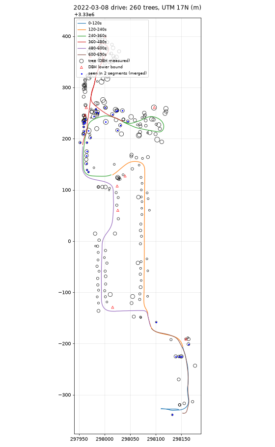
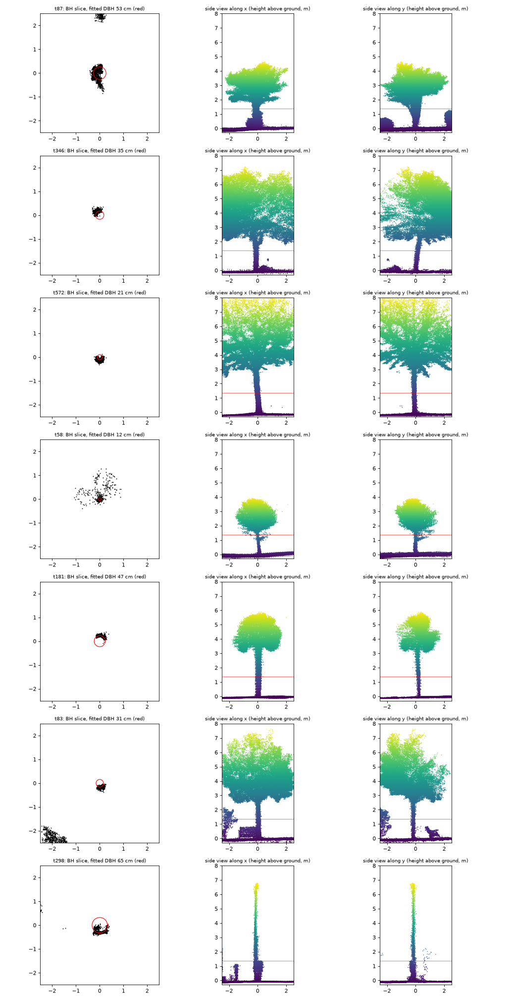

# Real-data run: the whole 2022-03-08 drive

**Status: partial results.** No tape DBH exists yet, so these files show what the pipeline finds on a whole mobile-lidar drive. They are plausibility checks, not accuracy figures.

The 11.4-minute drive (2.2 km, vehicle-mounted Ouster 64-beam lidar, standalone GNSS, rural north Florida; see [the first segment](../2022-03-08_ouster_segment/README.md)) was processed in six segments with the code of release 0.1.7, all with the default settings:

```bash
python scripts/register_rosbag_kiss_icp.py drive.bag --start 120 --duration 120 -o segment_120-240s.laz   # each segment
fip inventory segment_120-240s.laz -o segment_120-240s --output-units ft -e csv -e dxf -e geojson
fip georeference segment_120-240s/trees.csv -t segment_120-240s_trajectory.csv -g drive.bag
fip merge segment_*/ -o merged
```

| Segment | Trees | GNSS fit residual | Shift onto the other segments (from shared trees) |
|---|---|---|---|
| 0-120 s | 11 | 0.68 m | 0.95 m (5 shared trees, spread 0.04 m) |
| 120-240 s | 48 | 0.49 m | reference (best fit) |
| 240-360 s | 75 | 1.59 m | 2.47 m (5 shared trees, spread 0.15 m) |
| 360-480 s | 110 | 2.72 m | 2.22 m (17 shared trees, spread 0.20 m) |
| 480-600 s | 51 | 0.71 m | none (no shared trees) |
| 600-690 s | 14 | 0.50 m | none (no shared trees) |

**309 records → 269 trees**: 40 trees were seen in two segments and kept once. After tying the segments together on their shared trees, 32 of the 40 merged pairs lie within 0.36 m of each other. Without it, the same pairs were 1.9-2.6 m apart: the two segments in the trees (240-480 s) have the weakest GNSS (reported ±1.2-1.4 m, residuals of 1.6 and 2.7 m), where a rigid alignment is off by a few metres.



The trees line the farm roads. A random sample from the western road (segment 480-600 s) is six trees with rounded crowns and one 6.7 m pole without a crown (a utility pole or a dead snag; poles pass the trunk checks):



## Files

| File | Content |
|---|---|
| `trees_merged_wgs84.csv` | The 269 trees: latitude/longitude, UTM 17N (EPSG:32617) easting/northing, DBH and its interval, `dbh_method`, the segment and its tree number, and which other segment also saw it |
| `trees_merged_wgs84.geojson`, `trees_merged.gpx` | The same, for GIS and for a phone or handheld GPS in the field |
| `field_sheet.csv` | The form for the field check: fill in `tape_dbh_cm` and `is_tree`, then `fip calibrate trees_merged_wgs84.csv field_sheet.csv` |
| `merge_report.json` | Every shift and every merged pair with its distance and both DBH |
| `drive_map.png`, `avenue_trees_sample.png` | The images above |

## Known limits seen here

- **Positions** are as good as the GNSS: about ±1 m where the fit residual is under 1 m, a few metres in the two weak segments (their relative positions are tied; the whole is still only as good as the reference segment).
- **DBH** of trees seen from the road is often from one side; several circles look larger than their trunks in the side views. Only tape measurements can tell.
- **Poles** without a crown pass; exclude them in the app (the review is saved and reapplied).
