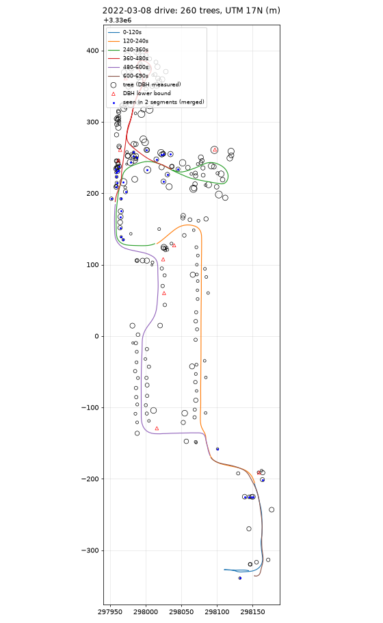
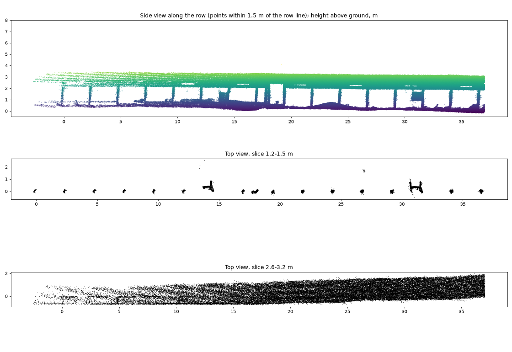
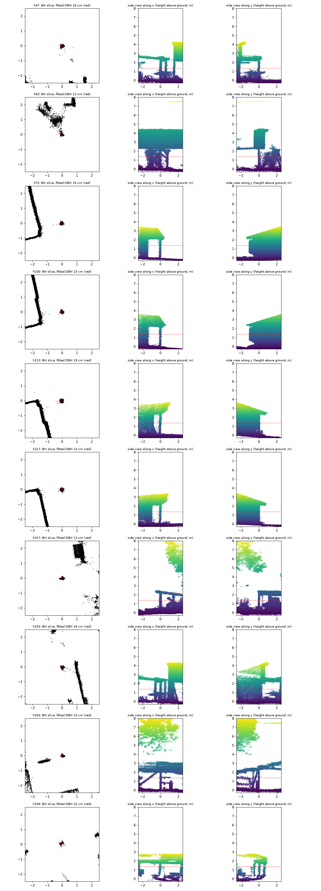
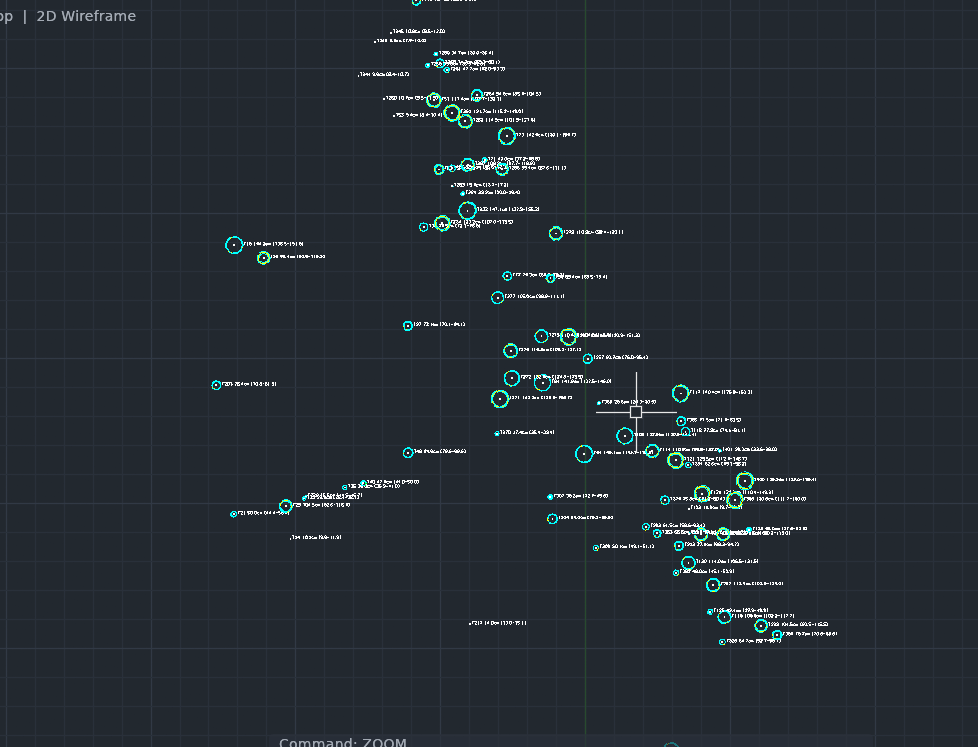
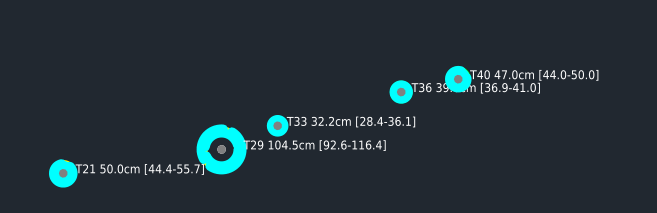
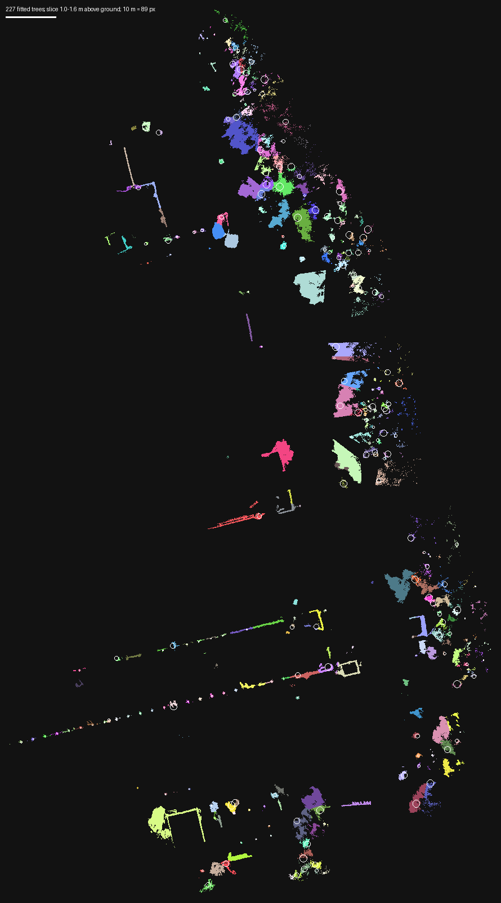
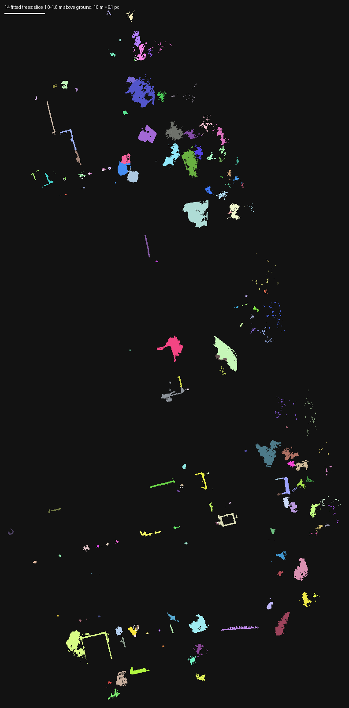

# Tested on real data

The pipeline has been run on a real drive at a rural site in north Florida (about 30.0818° N, 83.0944° W; standalone GNSS, no RTK, so about ±1 m), recorded from a vehicle-mounted Ouster 64-beam lidar and stitched with the included KISS-ICP script: first one 2-minute segment ([files and images](2022-03-08_ouster_segment/README.md)), then the whole 11-minute drive in six segments, merged into one map of **260 trees** ([results](2022-03-08_drive/README.md)). No field DBH exists yet, so these are plausibility checks, not accuracy figures. What image review of the results changed:

- **The trunk check.** Without it, 227 of 308 clusters on the first segment were "measured", most of them shrubs, posts, walls and scatter.
- **Roof posts.** A row of 16 evenly spaced objects under a flat layer was taken for a planted row of trees with low crowns (the check zone was made to end at the crown base to keep them). The site owner confirmed it is an **open shed**, 40 m long; with carports and porches, 36 of the first segment's 53 "trees" were posts. The roof check rejects them (a smooth plane over the post; 28-60 % of the layer on it, against 8-12 % for trees), leaving 8 trees on that segment. A sample of rejections away from the shed was all posts.
- **Narrow strips of stems.** Seen through a fence or between stems, a strip of a 20-35 cm trunk fitted an 80-130 cm circle, or a 55° "lean". These trees are now kept with the visible width as a lower-bound DBH (`dbh_method` *visible width (lower bound)*).
- **Merging segments.** The segments' separate GNSS alignments disagreed by 1-2.5 m (more where GNSS was weak under the trees); tying them together on the trees they share brought 33 of the 39 trees seen twice to within 0.36 m.
- Also: a realistic convergence test (the iteration-limit warning had fired on 71 % of trees), 7.4 GB instead of 16.7 GB for 45 M points, and Ouster "no return" pixels dropped by the bag reader.

The whole drive, georeferenced and merged (UTM 17N); the trees line the farm roads:

**The shed** that was taken for a row of trees (side view along it, and top views at breast height and at roof height), and **objects the roof check rejects** away from it (porch, carport and shed posts):

**The DXF export.** `trees.dxf` draws each tree as a DBH circle with its confidence-interval rings, its centre point and a label (tree number, DBH, interval; `>=` for a lower-bound DBH), on separate layers (`FIP_DBH`, `FIP_DBH_WARN`, `FIP_CI`, `FIP_LABEL`, `FIP_ADDED` for reviewer-added trees, ...). How it looks in a CAD program, from an earlier export:

A close-up of an earlier run's DXF, on the shed posts (then still taken for trees): labels give tree number, DBH and its 95 % interval; the cyan band is the interval between the two CI rings.

**Breast-height slice from above, before the trunk check and after the first trunk check** (before the roof check, so many of the accepted circles on the left of the right image are shed and carport posts). Points 1.0-1.6 m above ground, coloured by cluster, with fitted DBH circles in white; local coordinates, route top to bottom, forest edge on the right.

| Before: 227 clusters measured | After the first trunk check: 53 |
|---|---|
|  |  |

## To do: real-data fixtures and results

Shed fixture and object fixtures (`tests/data/shed_row_2022-03-08.laz`, `tests/data/real_objects_2022-03-08.npz`):

- [ ] Add the objects flagged for review on the whole drive (6 possible poles, 4 possible shrubs) to `real_objects_2022-03-08.npz` once their identity is confirmed in the field, and pin their outcome in `test_real_objects.py`.
- [ ] Add roof types not yet seen: flat metal roofs, roofs steeper than about 37° (the plane search ignores them), and a tree growing through or beside a roof (it must stay a tree).
- [ ] Add a free-standing pole and a tall bare trunk (an old pine with a high crown) side by side, to test whether anything can tell them apart when the scanner's trajectory is known.

Whole-drive results (`2022-03-08_drive/`):

- [ ] **Field check**: walk `trees_merged.gpx`, fill in `field_sheet.csv` (tape DBH, is it a tree), then `fip calibrate trees_merged_wgs84.csv field_sheet.csv`. Publish the DBH bias, RMSE, interval coverage and false-positive rate here: so far there are no accuracy figures for real data.
- [ ] Settle the flagged objects (poles, shrubs) and the 10 lower-bound trees on site; save the decisions as `exclusions.json` and reapply them with `--exclusions`.
- [ ] Check whether DBH is overestimated for trees seen from one side (some circles looked larger than their trunks in side views).
- [ ] Improve the two weak segments (240-480 s, GNSS residuals 1.6 and 2.7 m): loop closure in the KISS-ICP stitching or RTK, instead of relying on the tie between segments.
- [ ] Process a segment **inside** the forest, where stems are seen from several sides, and check the untested profiles there (*Clear Forest*, *Shrubs*) and the non-vehicle scanner profiles on their own data.
- [ ] Check `--tile` on a whole-drive cloud stitched as one (memory, run time, and the trees against an untiled run).
- [ ] Share one ground model across tiles (e.g. ground filtered once on a thinned copy of the whole cloud), so tiled results no longer depend on the tile size: today 88 of 107 trees were identical on a real segment, the rest moved with the ground model.
